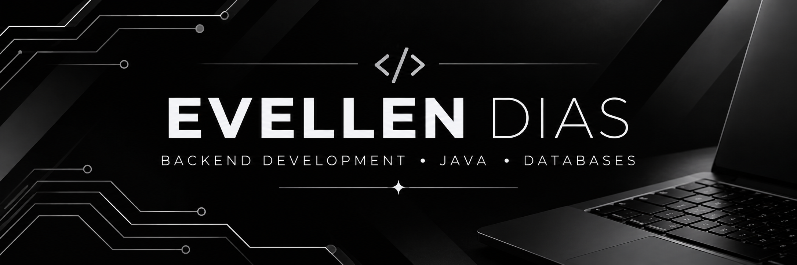

# EVELLEN DIAS

**Tecnologia | Desenvolvimento Backend | Java | Banco de Dados**

Estudante de tecnologia, formada como Técnica em Informática pela FAETEC e atualmente cursando Análise e Desenvolvimento de Sistemas e Engenharia da Computação.

Tenho interesse em desenvolvimento de software, principalmente na construção de aplicações backend, lógica de programação e gerenciamento de bancos de dados. Busco desenvolver minhas habilidades por meio de estudos e projetos práticos.

---

## ABOUT ME

- 🎓 Técnica em Informática — FAETEC.
- 💻 Graduanda em Análise e Desenvolvimento de Sistemas.
- 🎓 Graduanda em Engenharia da Computação.
- 💡 Interesse em desenvolvimento Backend e Engenharia de Software.
- 📚 Sempre buscando aprender e evoluir tecnicamente.

## TECH STACK

**Programming Languages**
- Java
- Python
- PHP
- JavaScript

**Databases**
- MySQL
- SQL Server

**Web Development**
- HTML5
- CSS3
- Bootstrap

**Tools**
- Git
- GitHub
- Visual Studio Code

## FEATURED PROJECTS

**EletroControl**  
Sistema de gerenciamento de serviços para profissionais autônomos da área de eletrotécnica. Desenvolvido com PHP, MySQL, HTML, CSS e JavaScript.

**Loja de Roupas — Database**  
Projeto de banco de dados com SQL Server, envolvendo criação de tabelas, organização de dados e consultas SQL.

**Sistema de Cadastro — Java**  
Projeto em desenvolvimento utilizando Java, Spring Boot e MySQL.

## CURRENT FOCUS

- Desenvolvimento backend com Java.
- Programação Orientada a Objetos.
- Spring Boot e APIs REST.
- Modelagem e relacionamentos de bancos de dados.
- Boas práticas de desenvolvimento de software.

## CONNECT WITH ME

[LinkedIn](https://linkedin.com/in/evellen-dias-62431b26a)  
[GitHub](https://github.com/evellendias-dev)
